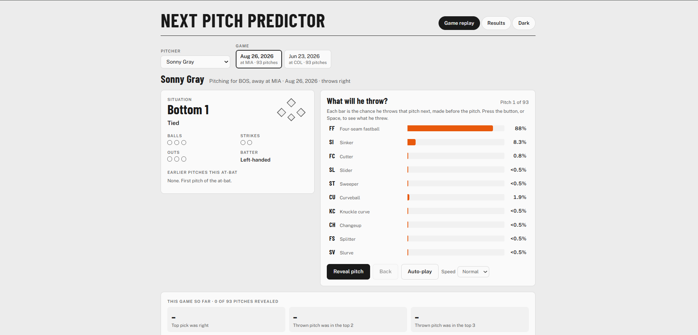
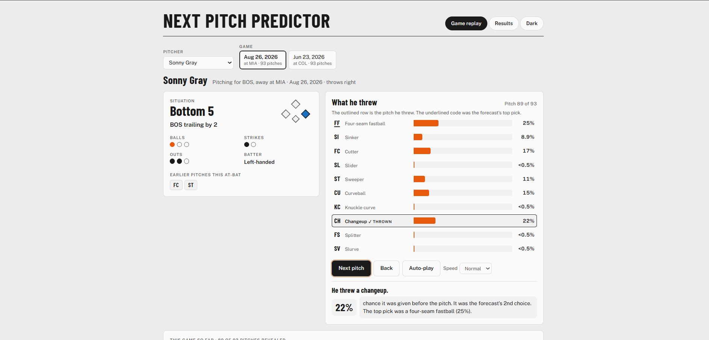
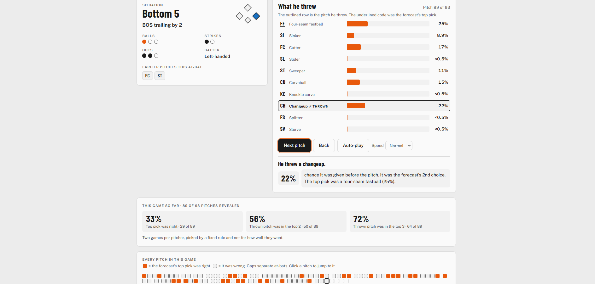
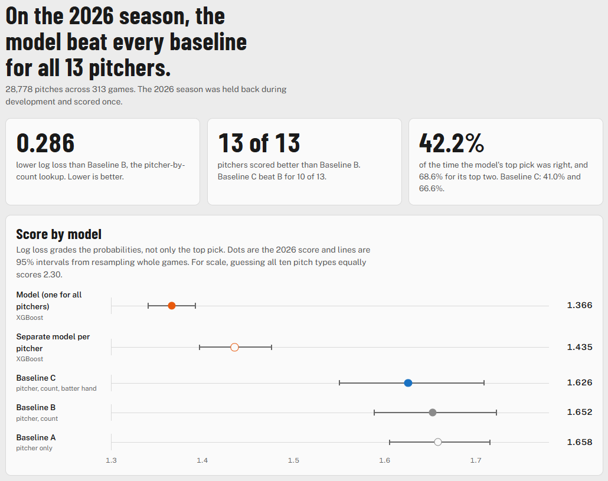
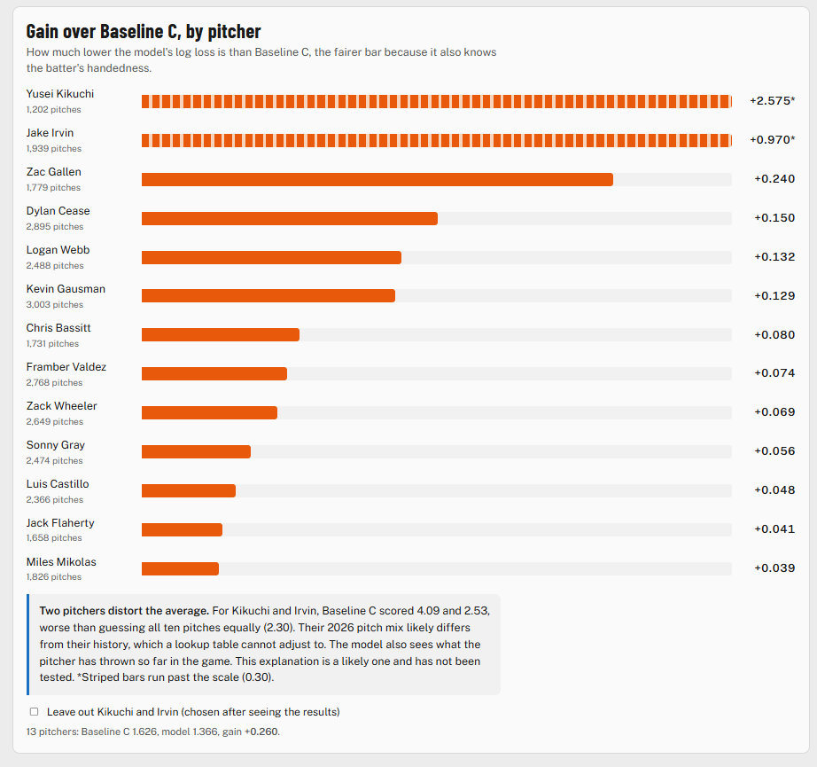

# Next Pitch Predictor

Predicts the next pitch type a starting pitcher will throw, using only what is known before the pitch (count, score, baserunners, batter handedness and what he has already thrown in the game), with an XGBoost model trained on MLB Statcast data and tested once on the 2026 season.

## Demo

**[Try the live demo](https://emig23.github.io/next-pitch-predictor/)**

The page replays real 2026 games one pitch at a time. For each pitch it shows the chance the model gave every pitch type before the pitch, then reveals what the pitcher actually threw. The Results tab shows how the model did over the whole test season.

### Game replay
Before the pitch, the model shows the chance of each pitch type:

<table>
<tr>
<td><b>Before the pitch</b><br></td>
</tr>
</table>

After revealing, the pitch he threw is outlined, with the chance the model gave it and a running score for the game:

<table>
<tr>
<td><b>After the reveal</b><br></td>
</tr>
</table>

<table>
<tr>
<td><b></b><br></td>
</tr>
</table>

### Results
<table>
<tr>
<td></td>
<td></td>
</tr>
</table>

## Overview
- **Data**: MLB Statcast pitch-by-pitch data via `pybaseball` (2023-2026, regular season)
- **Task**: 10-class pitch type prediction for 13 starting pitchers
- **Models compared**: three count-based baselines, a per-pitcher XGBoost and a single global XGBoost
- **Evaluation**: trained on 2023-2025, tested once on 2026 (28,778 pitches, 313 games)

## Model Comparison
Evaluated on the 2026 test season. Lower log loss is better.

| Model                              | Log Loss | Top-1 | Top-2 |
|------------------------------------|:--------:|:-----:|:-----:|
| A: pitcher's overall pitch mix     |  1.658   | 36.7% | 61.8% |
| B: A plus ball-strike count        |  1.652   | 39.4% | 63.8% |
| C: B plus batter handedness        |  1.626   | 41.0% | 66.6% |
| Per-pitcher XGBoost                |  1.435   | 41.9% | 67.7% |
| Global XGBoost                     |  1.366   | 42.2% | 68.5% |

**Chosen as the final model: Global XGBoost.** It beats baseline B by 0.286 log loss (95% interval 0.233 to 0.344) and the stronger baseline C by 0.260 (95% interval 0.194 to 0.333), using a paired bootstrap over games (2,000 draws). It also beats baseline B for all 13 of 13 pitchers and one model trained on every pitcher beat separate models trained per pitcher.

The gain in top-1 accuracy is small (42.2% vs 41.0% for C). Most of the improvement is in the probabilities themselves: the model is much better at saying how likely each pitch is, even when its single top pick is only right about 42% of the time. Top-3 accuracy is not in the table, but in the live demo it looked solid: the pitch thrown was usually among the model's top three choices.

## How It Works
1. **Data**: regular-season Statcast pitches, stored as Parquet.
2. **Pitchers**: 15 starters were chosen using 2023-2025 data only (at least 1,500 pitches and at least 80% of appearances as a starter). 13 have 2026 pitches and make up the test set.
3. **Target**: 10 pitch types: four-seam, sinker, cutter, slider, sweeper, curveball, knuckle curve, changeup, splitter, slurve.
4. **Features**: only information available before the pitch, checked by leakage tests.
5. **Split**: during development, fit on 2023-24 and evaluate on 2025. For the final run, fit on 2023-25 and evaluate on 2026.
6. **Metrics**: log loss, top-k accuracy and calibration.

## Project Structure
```
next-pitch-predictor/
├── src/               # data prep, features, baselines, models, evaluation
│   ├── prep/          # data pulling, pitcher selection, cleaning
│   ├── baselines.py
│   ├── features.py
│   ├── models.py
│   ├── evaluate.py
│   ├── calibration.py
│   ├── run_baselines.py
│   ├── run_models.py
│   └── run_final.py
├── tests/             # unit and leakage tests
├── results/           # saved settings and final results
├── app/               # demo data export
└── docs/              # demo page (served by GitHub Pages)
```

## Setup
```bash
git clone https://github.com/emig23/next-pitch-predictor
cd next-pitch-predictor

python -m venv .venv
.venv\Scripts\activate        # macOS/Linux: source .venv/bin/activate
pip install -r requirements.txt
python -m pytest tests -q
```
Requires Python 3.11.

## Usage

The data is not in the repo. **Rebuild it** (the pulls take a while, `pybaseball` caches them):
```bash
python -m src.prep.pull_selection_data
python -m src.prep.select_pitchers
python -m src.prep.pull_final_data
python -m src.prep.clean_data
```

**Run the baselines and models:**
```bash
python -m src.run_baselines
python -m src.run_models
```

**Final evaluation on the 2026 season:**
```bash
python -m src.run_final --confirm-final
```
`results/final_results.json` is already committed, so this refuses to run again unless that file is deleted. That is on purpose, because the test season is meant to be used once.

**Rebuild the demo data:**
```bash
python -m app.export_demo
```

## Technical Notes
- **Test season used once**: the final run needs `--confirm-final` and refuses to run if results already exist. No setting or model was changed after seeing 2026 results.
- **Leakage tests**: tests check that features use only information from before the pitch.
- **Honest baselines**: the model is compared against count-based and handedness-based baselines, not just a most-common-pitch guess, so the gain reflects more than knowing the count.
- **Rare pitch folded in**: slow curveballs (CS, about 0.03% of pitches) are folded into the curveball class.

## Limitations
- Only 13 pitchers and one test season, so the results should not be read as covering all of MLB.
- It predicts pitch type only, not location or speed.
- Two pitchers, Yusei Kikuchi and Jake Irvin, distort the average gain over baseline C. Baseline C scored 4.09 and 2.53 on them, worse than guessing all ten pitch types equally (2.30). Their 2026 pitch mix likely differs from their history, which a lookup table cannot adjust to, while the model also sees what the pitcher has thrown so far in the game. This explanation is likely but has not been tested. Without those two the gain is smaller but still positive for every pitcher. The demo's Results tab has a checkbox to leave them out.
- The top-1 gain over the strongest baseline is small.

## Ideas for extending this project
- Add more pitchers, including relievers and more seasons.
- Add features such as batter-versus-pitcher history or recent fatigue.
- Compare other model types against XGBoost.

## Acknowledgments
- [Claude](https://claude.ai) by Anthropic, used as an AI coding assistant to write and test the code under my direction
- [MLB Statcast](https://baseballsavant.mlb.com/statcast_search) data from Baseball Savant
- [pybaseball](https://github.com/jldbc/pybaseball) for data access
